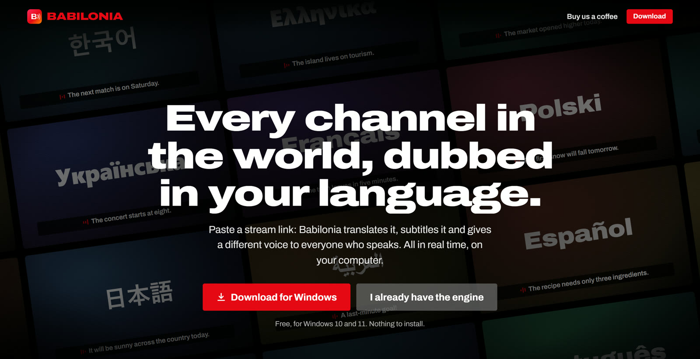
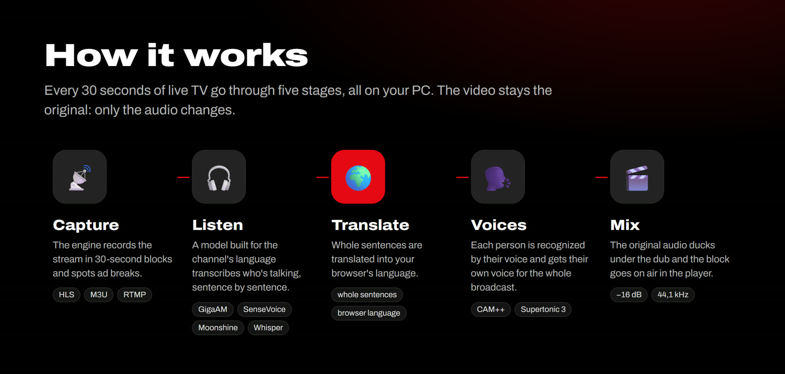
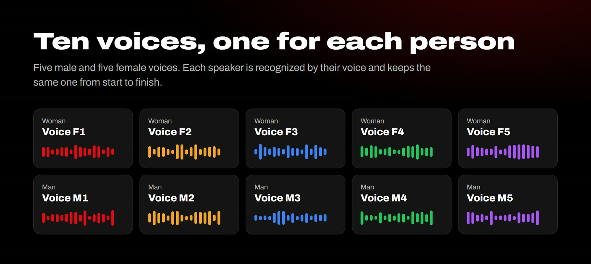
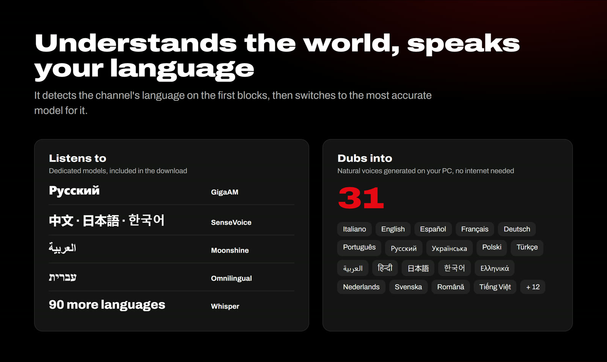
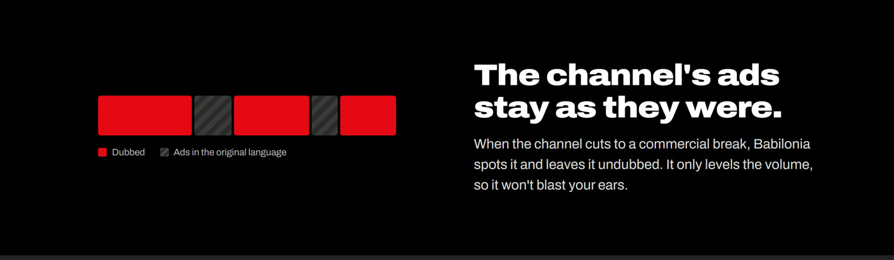

[🇮🇹 Italiano](README.md) | **🇬🇧 English**

# Babilonia TV

### Every channel in the world, dubbed in your language. Live.

 

&nbsp;

Free. Nothing to install: unzip it and start it.

 

Paste a stream link and Babilonia **listens to it, translates it and re-dubs it** into your browser's language while it's on air. Every person who speaks gets **their own voice**, subtitles come for free and the channel's ads stay as they were. Your PC does the heavy lifting: no video goes through our servers.

 

## ✨ Why it's different

| | |
|---|---|
| 🎙️ **A voice for every person** | It recognizes who's speaking by their voice and gives each person their own, fixed for the whole broadcast. Ten voices, five male and five female. |
| 🧠 **Specialized ears** | It detects the channel's language by itself and switches to the most accurate model: Russian, Chinese, Japanese, Korean, Arabic and Hebrew each get a dedicated one. |
| 🗣️ **Natural voices, offline** | Voices are generated on your PC in 31 languages. |
| 📺 **Ads stay ads** | It spots commercial breaks and leaves them in the original language, with the volume leveled. |
| 🔒 **Actually private** | Audio and video stay on your computer. No account, no subscription. |
| 🧳 **Portable** | Everything in one folder: Python, FFmpeg and models included. To uninstall, delete it. |

 

 

## 🚀 How to use it

1. **Download** [the ZIP](https://github.com/pilgrimdelamare/babilonia-tv-releases/releases/latest/download/Babilonia_Engine_Windows.zip) and extract it to a folder.
2. **Start** `Avvia_Babilonia_Engine.bat`. The Babilonia icon appears next to the clock and the player opens.
3. **Paste** a stream link (`.m3u8`) or load an `.m3u` playlist. About a minute later you're watching it dubbed.

> [!TIP]
> If your browser asks to **access devices on your local network**, choose *Allow*: it only lets the page talk to the engine on your PC.
>
> If Windows shows **"Windows protected your PC"**, click *More info* → *Run anyway*.

 

## 💻 Requirements

| | Minimum | Recommended |
|---|---|---|
| System | Windows 10 or 11, 64-bit | Windows 11 |
| Processor | 4 threads | 8 threads or more |
| Memory | 8 GB | 16 GB |
| Disk | 1.5 GB | 3 GB (for extra models) |
| Browser | Chrome, Edge, Brave, Firefox | Chrome or Edge |

No graphics card needed. On faster PCs the engine downloads the larger Arabic and Hebrew models by itself.

 

## ❓ FAQ

<b>How much does it cost?</b>

Nothing. Babilonia TV is free, with no subscription. If you like it you can [buy us a coffee](https://paypal.me/alemarasso).

<b>Which languages does it translate from?</b>

It detects the source language by itself among 90+. Russian, Chinese, Japanese, Korean, Cantonese, Arabic and Hebrew have a dedicated, more accurate model. It dubs with natural voices into 31 languages and uses online voices for the others.

<b>How far behind live is it?</b>

About a minute at start, the time it takes to prepare the first 30-second blocks. While you wait, the player shows what the engine is doing, block by block.

<b>Does Babilonia TV provide channels?</b>

No. It's a player, like VLC: it doesn't provide, host or index any channel. Only open streams you have the right to watch.

<b>Why does my browser ask to access the local network?</b>

That's how the site talks to the engine running on your PC (address `127.0.0.1`). It doesn't access other devices and nothing leaves your computer.

<b>How do I uninstall it?</b>

Close the engine (right-click the icon next to the clock → *Esci*) and delete the folder. It leaves nothing behind.

 

## 🧩 Built with

Babilonia brings together amazing open source projects:
[FFmpeg](https://ffmpeg.org) ·
[faster-whisper](https://github.com/SYSTRAN/faster-whisper) ·
[sherpa-onnx](https://github.com/k2-fsa/sherpa-onnx) ·
[GigaAM](https://github.com/salute-developers/GigaAM) ·
[SenseVoice](https://github.com/QwenAudio/SenseVoice) ·
[Moonshine](https://github.com/moonshine-ai/moonshine) ·
[Omnilingual ASR](https://github.com/facebookresearch/omnilingual-asr) ·
[3D-Speaker CAM++](https://github.com/modelscope/3D-Speaker) ·
[Supertonic](https://github.com/supertone-oss-archive/supertonic)

 

### ☕ Enjoying Babilonia TV?

It's free and it'll stay free. A coffee helps keep it alive.

  

Babilonia TV is a neutral AI player and translator, like VLC or Kodi: it does not provide, host or index any channel, stream or TV content. Users are solely responsible for the sources they open and must have the right to watch them. Translations and voices are generated automatically and may contain errors.

