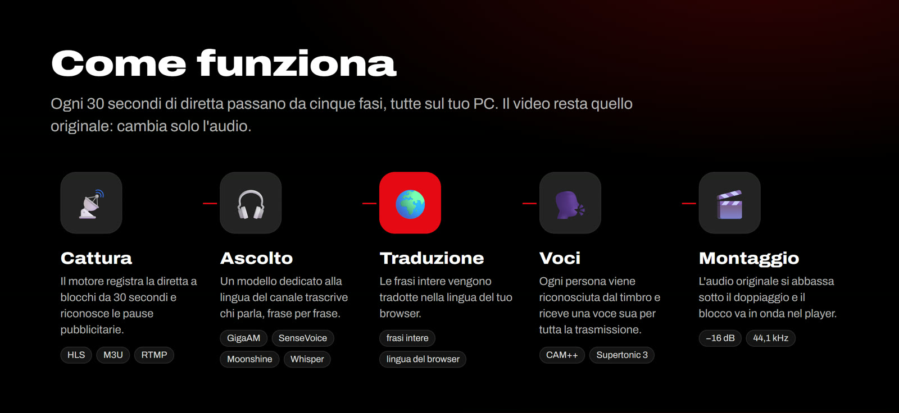
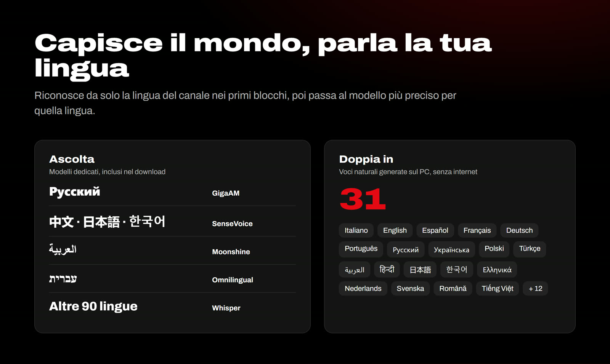
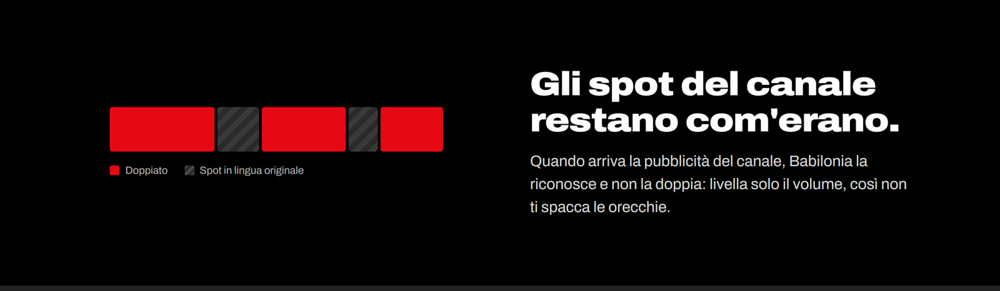

**🇮🇹 Italiano** | [🇬🇧 English](README.en.md)

# Babilonia TV

### Ogni canale del mondo, doppiato nella tua lingua. In diretta.

 

&nbsp;

Gratis. Nessuna installazione: si estrae lo ZIP e si avvia.

 

Incolli il link di uno stream e Babilonia lo **ascolta, lo traduce e lo ridoppia** nella lingua del tuo browser, mentre va in onda. Ogni persona che parla ha **la sua voce**, i sottotitoli sono già pronti e la pubblicità del canale resta com'era. Il lavoro pesante lo fa il tuo PC: nessun video passa dai nostri server.

 

## ✨ Perché è diverso

| | |
|---|---|
| 🎙️ **Una voce per ogni persona** | Riconosce chi parla dal timbro e gli dà una voce sua, fissa per tutta la trasmissione. Dieci voci, cinque maschili e cinque femminili. |
| 🧠 **Orecchie specializzate** | Capisce da sola la lingua del canale e passa al modello più preciso: russo, cinese, giapponese, coreano, arabo, ebraico hanno un modello dedicato. |
| 🗣️ **Voci naturali, senza internet** | Le voci vengono generate sul tuo PC in 31 lingue, italiano compreso. |
| 📺 **Gli spot restano spot** | Riconosce le pause pubblicitarie e le lascia in lingua originale, con il volume livellato. |
| 🔒 **Privato per davvero** | Audio e video restano sul tuo computer. Niente account, niente abbonamenti. |
| 🧳 **Portatile** | Tutto in una cartella: Python, FFmpeg e modelli inclusi. Per disinstallare la cancelli. |

 

 

## 🚀 Come si usa

1. **Scarica** [lo ZIP](https://github.com/pilgrimdelamare/babilonia-tv-releases/releases/latest/download/Babilonia_Engine_Windows.zip) ed estrailo in una cartella.
2. **Avvia** `Avvia_Babilonia_Engine.bat`. Compare l'icona di Babilonia vicino all'orologio e si apre il player.
3. **Incolla** il link di uno stream (`.m3u8`) o carica una playlist `.m3u`. Dopo circa un minuto lo guardi doppiato.

> [!TIP]
> Se il browser chiede di **accedere ai dispositivi della rete locale**, scegli *Consenti*: serve solo a far parlare la pagina con il motore sul tuo PC.
>
> Se Windows mostra **"PC protetto da Windows"**, clicca *Ulteriori informazioni* → *Esegui comunque*.

 

## 💻 Requisiti

| | Minimo | Consigliato |
|---|---|---|
| Sistema | Windows 10 o 11, 64 bit | Windows 11 |
| Processore | 4 thread | 8 thread o più |
| Memoria | 8 GB | 16 GB |
| Spazio | 1,5 GB | 3 GB (per i modelli extra) |
| Browser | Chrome, Edge, Brave, Firefox | Chrome o Edge |

Non serve una scheda video. Sui PC più veloci il motore scarica da solo i modelli più grandi per arabo ed ebraico.

 

## ❓ Domande frequenti

<b>Quanto costa?</b>

Niente. Babilonia TV è gratis e senza abbonamenti. Se ti piace puoi [offrirci un caffè](https://paypal.me/alemarasso).

<b>Da quali lingue traduce?</b>

Riconosce da solo la lingua di partenza tra oltre 90. Russo, cinese, giapponese, coreano, cantonese, arabo ed ebraico hanno un modello dedicato, più preciso. Doppia con voci naturali in 31 lingue; per le altre usa voci online.

<b>Quanto ritardo c'è rispetto alla diretta?</b>

Circa un minuto all'avvio, il tempo di preparare i primi blocchi da 30 secondi. Durante l'attesa il player mostra cosa sta facendo il motore, blocco per blocco.

<b>Babilonia TV fornisce i canali?</b>

No. È un player, come VLC: non fornisce, non ospita e non indicizza canali. Apri solo stream che hai il diritto di guardare.

<b>Perché il browser chiede di accedere alla rete locale?</b>

È il modo in cui il sito parla con il motore che gira sul tuo PC (indirizzo `127.0.0.1`). Non accede ad altri dispositivi e niente esce dal tuo computer.

<b>Come lo disinstallo?</b>

Chiudi il motore (clic destro sull'icona vicino all'orologio → *Esci*) e cancella la cartella. Non lascia niente altrove.

 

## 🧩 Costruito con

Babilonia mette insieme progetti open source straordinari:
[FFmpeg](https://ffmpeg.org) ·
[faster-whisper](https://github.com/SYSTRAN/faster-whisper) ·
[sherpa-onnx](https://github.com/k2-fsa/sherpa-onnx) ·
[GigaAM](https://github.com/salute-developers/GigaAM) ·
[SenseVoice](https://github.com/QwenAudio/SenseVoice) ·
[Moonshine](https://github.com/moonshine-ai/moonshine) ·
[Omnilingual ASR](https://github.com/facebookresearch/omnilingual-asr) ·
[3D-Speaker CAM++](https://github.com/modelscope/3D-Speaker) ·
[Supertonic](https://github.com/supertone-oss-archive/supertonic)

 

### ☕ Ti piace Babilonia TV?

È gratis e lo resterà. Un caffè aiuta a tenerlo vivo.

  

Babilonia TV è un player e traduttore neutro, come VLC o Kodi: non fornisce, non ospita e non indicizza canali, stream o contenuti televisivi. Gli utenti sono gli unici responsabili delle fonti che aprono e devono avere il diritto di guardarle. Traduzioni e voci sono generate automaticamente e possono contenere errori.

